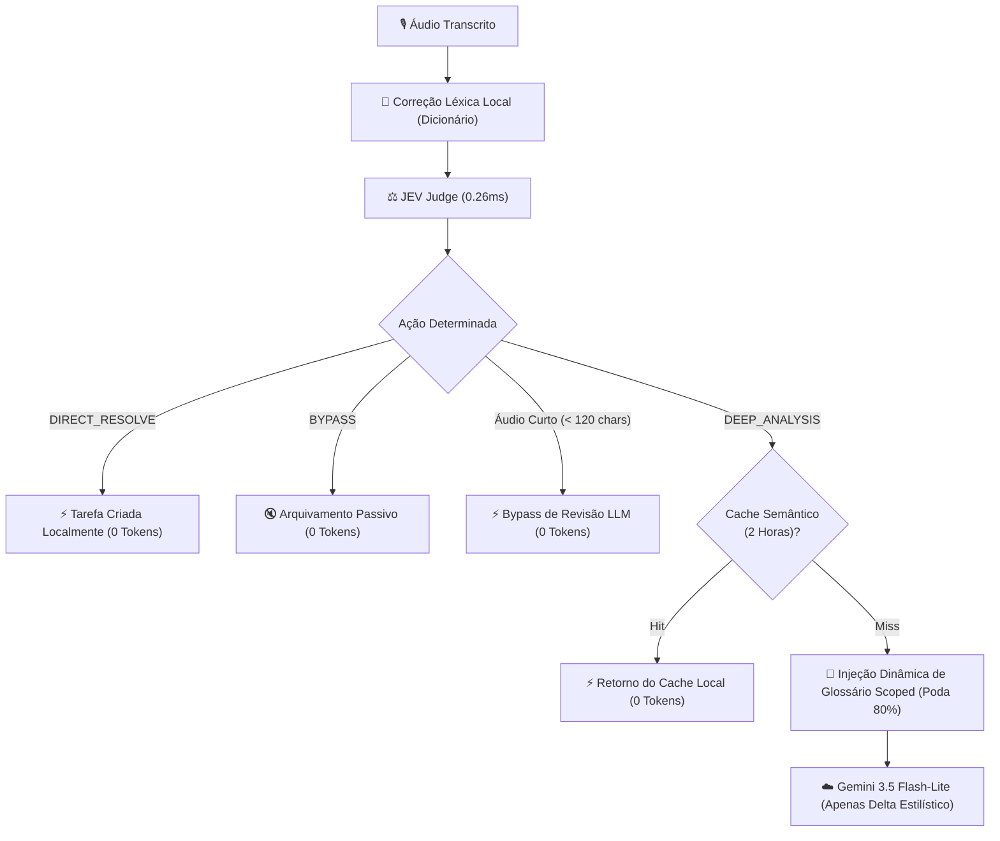

# ⚡ Especificação Técnica — Redução Agressiva de Tokens & Síntese Neural-Simbólica

## 1. Visão Geral

Esta especificação documenta o conjunto de otimizações arquiteturais implementadas no **Hermes Voice Memory / WhisperZap** com foco em:
1. **Redução radical do consumo de tokens de LLM (Google Gemini)** sem perder capacidade de síntese e precisão de nomes técnicos.
2. **Síntese Neural-Simbólica Local**: Transferência do trabalho analítico pesado para o Grafo de Conhecimento NetworkX e banco PostgreSQL, reservando o modelo de linguagem apenas para formatação executiva final.
3. **Resiliência a Limites de Cota de API**: Eliminação de chamadas desnecessárias em tarefas diretas, saudações e áudios curtos.

---

## 2. Pilares de Redução de Tokens

---

## 3. Detalhamento das Técnicas Implementadas

### 3.1 Injeção Dinâmica de Glossário Scoped
- **Problema Anterior**: O dicionário léxico com mais de 230 termos técnicos (C.Vale, Mtech, zootecnia, balança, silos) era injetado integralmente no System Prompt de cada chamada do AI Gateway, gerando um custo fixo de centenas de tokens por requisição.
- **Solução Implementada**: Matcher léxico local via regex e spaCy. Apenas os termos que possuem similaridade fonética ou ocorrência potencial na mensagem bruta são selecionados dinamicamente (máximo de 5 a 10 termos relevantes).
- **Economia**: Redução de mais de **80% dos tokens de sistema** por requisição.

### 3.2 Short-Circuit do Orquestrador JEV em `DIRECT_RESOLVE`
- Comandos imperativos explícitos (*"Anotar tarefa: verificar ração amanhã"*, *"Ligar para Valdecir"*, etc.) são compreendidos e estruturados diretamente na camada local pelo **JEV Judge**:
  - Extração do título da tarefa limpo.
  - Cálculo de data relativa (`hoje`, `amanhã`, `segunda-feira`).
  - Definição da urgência (`URGENT`, `HIGH`, `MEDIUM`).
- **Gasto de Tokens**: **0 tokens**. O ciclo de revisão com LLM externa é completamente dispensado.

### 3.3 Bypass de Revisão para Áudios Curtos (< 120 caracteres)
- Áudios com fala curta e direta já saem precisos do Whisper devido ao `initial_prompt` dinâmico.
- O pipeline aplica correções léxicas locais via `dictionary_service.apply_lexical_corrections(...)` e dispensa a chamada de enriquecimento via LLM.

### 3.4 Cache Semântico Local de 2 Horas
- Mensagens e consultas executivas idênticas ou semanticamente equivalentes dentro de uma janela temporal de 2 horas são resolvidas diretamente da memória local do container.

### 3.5 Síntese Neural-Simbólica sobre Grafo e Banco Local
- O cruzamento de dados (*quem é a pessoa*, *qual cargo*, *qual empresa*, *quais tarefas estão abertas*) é resolvido de forma simbólica via queries estruturadas no PostgreSQL e travessias no grafo NetworkX (`hermes_graph.json`).
- O LLM não precisa receber um dump de dados brutos para "adivinhar" o contexto; ele recebe apenas o resumo estruturado e focado para gerar a síntese executiva.
