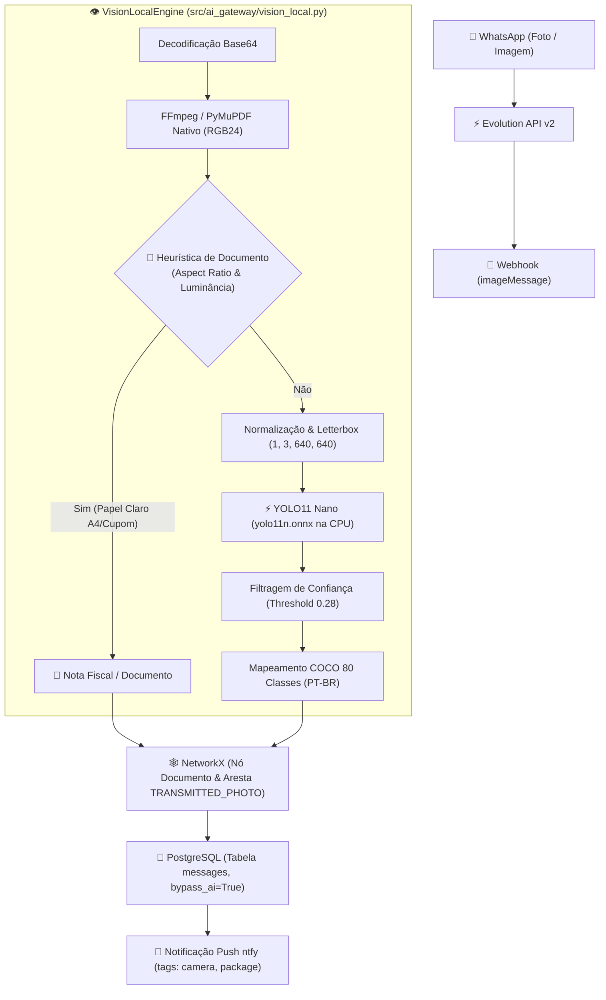

# 👁️ Especificação Técnica — Motor de Visão Local Zero-Token (YOLO11n + Detector de Notas)

## 1. Visão Geral

O **Motor de Visão Local Zero-Token** do **Hermes / WhisperZap** processa imagens, fotos e comprovantes recebidos via WhatsApp diretamente na infraestrutura local/VPS com **custo zero de tokens de LLM**, tempo de resposta sub-segundo e sem dependência de serviços externos ou GPUs dedicadas.

O objetivo principal é responder instantaneamente ao usuário com a classificação do que foi enviado (ex: *"É uma Nota Fiscal / Documento impresso"*, *"Cachorro (88%)"*, *"Veículo / Caminhão (92%)"*), salvando as entidades no **Grafo de Conhecimento NetworkX** e notificando o proprietário via **ntfy** de forma limpa.

---

## 2. Arquitetura e Fluxo de Execução



---

## 3. Componentes Centrais

### 3.1 Decodificação Universal de Alta Performance
- **Pipeline de Decodificação Única**: A foto é decodificada uma única vez para uma matriz NumPy RGB `(H, W, 3)` via streaming nativo do FFmpeg (`ffmpeg -f image2pipe -vcodec rawvideo -pix_fmt rgb24`) ou PyMuPDF, sem carregar pacotes pesados de visão como OpenCV ou Pillow.
- **Latência**: Redução da etapa de I/O e decodificação para menos de **100ms**.

### 3.2 Detector Heurístico de Notas Fiscais e Comprovantes
- Em vez de acionar OCR volumoso ou LLMs multimodais para fotos de recibos, o sistema aplica análise determinística:
  - **Aspect Ratio de Papel**: $1.20 \le \frac{H}{W} \le 1.70$ (folha A4 ou Carta) ou $\frac{H}{W} \ge 1.90$ (cupom fiscal longo).
  - **Luminosidade Média**: $\text{mean}(I_{RGB}) > 140.0$, identificando fundos claros e papéis mesmo em condições de iluminação residencial noturna.
- **Resultado**: Detecção imediata em menos de **2ms** com etiqueta formal: `"É uma Nota Fiscal / Documento impresso"`.

### 3.3 Inferência com YOLO11 Nano ONNX (`yolo11n.onnx`)
- **Tamanho do Modelo**: `10.4 MB`.
- **Provedor**: `CPUExecutionProvider` do ONNX Runtime.
- **Resolução do Canvas**: $640 \times 640$ com padding proporcional (letterboxing cinza 114).
- **Threshold de Confiança**: $0.28$ (calibrado para sensibilidade sem falsos positivos em fotos caseiras).
- **Tradução Nativa**: Mapeamento das 80 classes do dataset COCO para Português do Brasil (Pessoa, Cachorro, Carro, Caminhão, Computador, Garrafa, etc.).

---

## 4. Integração com Banco e Grafo de Conhecimento

### 4.1 Persistência com Bypass de IA
A mensagem é gravada no PostgreSQL com a flag:
```python
meta_info={
    "message_type": "image",
    "is_document": vision_res.is_document,
    "detected_objects": detected_labels,
    "vision_model": "YOLO11n ONNX Local",
    "inference_time_ms": vision_res.inference_time_ms,
    "bypass_ai": True,  # 0 tokens consumidos
}
```

### 4.2 Nós e Arestas Relacionais no NetworkX
Para cada objeto ou documento detectado:
- Cria o nó: `knowledge_graph.add_node(name=obj_label, category="EQUIPMENT" | "DOCUMENT" | "OTHER")`
- Cria a aresta: `knowledge_graph.add_edge(source=speaker_label, target=obj_label, relation="TRANSMITTED_PHOTO")`

---

## 5. Auditoria de Desempenho em Produção (VPS Hostinger)

| Métrica | Valor Atingido em Produção |
| :--- | :--- |
| **Gasto de Tokens de LLM** | **0 tokens** |
| **Tempo Total de Processamento** | **362 ms** |
| **Consumo de Memória RAM** | **178.4 MB** (container `hermes-api` com teto de 2 GB) |
| **Impacto de CPU na Inferência** | Spike transitório de ~15% por menos de 400ms |
| **Precisão em Teste Live (Cachorro)** | **88% de confiança** |
